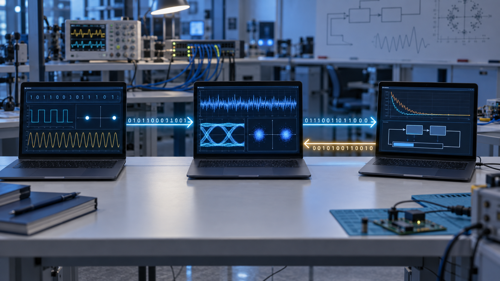
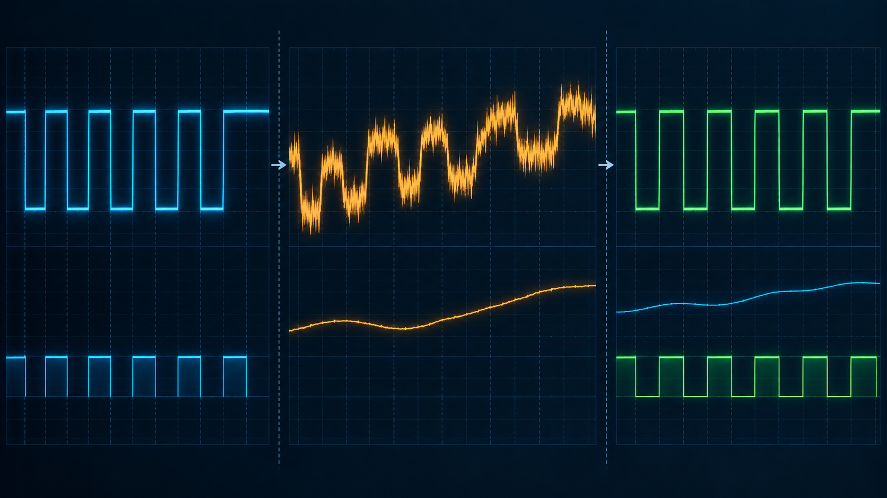

# Streaming Live Kalman Filter

## Illustrated project architecture report

This report maps the implemented repository architecture to a clear presentation narrative. The system runs as three independently deployable Go services connected through versioned gRPC and Protocol Buffers contracts.

*Figure 1. The demonstration uses three laptops: the Sender produces BPSK sample frames, the Receiver performs Kalman-assisted demodulation, and the Controller evaluates receiver metrics and returns configuration decisions.*

## 1. System objective

The project demonstrates reliable digital data transfer through a simulated impaired BPSK channel. It combines streaming signal processing, a stateful Kalman estimator, real-time telemetry, an optional ONNX adaptation policy, and desktop or mobile monitoring interfaces.

The Wi-Fi or TCP network carries digitized samples between machines. It does not act as the experimental radio channel. The Sender software introduces Gaussian noise, slow fading, DC drift, and optional noise bursts before transmitting each sample frame.

## 2. Three-node deployment

| Node | Main responsibility | Interfaces |
| --- | --- | --- |
| Sender, Laptop 1 | File framing, scrambling, BPSK modulation, channel simulation and sample streaming | `TransmitterService`, Sender HTTP transfer API and outbound `ReceiverService.ProcessSignal` stream |
| Receiver, Laptop 2 | Frame validation, Kalman DC tracking, BPSK decisions, BER/SNR metrics, file reconstruction and media publication | `ReceiverService`, `MediaStreamService` and ESP32-compatible HTTP endpoint |
| Controller, Laptop 3 | Metrics windows, rule or ONNX adaptation, versioned configuration decisions and experiment telemetry | `ControllerService`, HTTP state API and SSE event stream |

All three nodes also implement `common.v1.NodeService` for discovery, capabilities and health monitoring.

## 3. Signal-processing path

*Figure 2. Conceptual signal flow. The Sender creates BPSK symbols, the simulated channel introduces noise and baseline drift, and the Receiver uses Kalman DC tracking followed by integrate-and-dump decisions.*

The default configuration uses a 48 kHz sample rate, 512 samples per frame and eight samples per BPSK symbol. This produces 93.75 frames per second and 64 symbol decisions per frame.

The Receiver deliberately estimates the slowly changing DC offset rather than smoothing individual signal samples. It averages blocks of balanced BPSK symbols, updates a scalar Kalman state, subtracts the estimated offset and then makes hard BPSK decisions. Simulation-only reference bits allow BER measurement but do not drive the signal-quality estimates.

For media transfers, the complete order is:

1. Read file bytes and optionally apply the educational byte-shift transform.
2. Scramble payload bytes to balance the transmitted bits.
3. Convert bits into BPSK symbols and generate noisy samples.
4. Stream framed samples to the Receiver.
5. Track DC drift and make BPSK decisions.
6. Descramble and reverse the optional byte shift.
7. Reassemble the transfer, verify its CRC and detect its content type.
8. Publish text, image, audio or binary chunks through the common media stream.

## 4. Adaptive feedback loop

*Figure 3. The Receiver sends compact metrics to the Controller. The Controller evaluates a rolling window and returns bounded Q/R values that take effect at a future frame boundary.*

The Controller supports two interchangeable policies:

- The rule policy sets `R` from the latest estimated noise variance and maintains a fixed tracking ratio of `Q/R = 0.0268`.
- The ONNX policy evaluates six features from the latest 12 receiver metrics and predicts the Q/R tracking ratio. The Controller clamps its result to the trained range before issuing a versioned decision.

Each decision includes a command identifier, configuration version and future effective sequence. The Receiver rejects stale decisions and applies accepted updates only at a frame boundary.

## 5. Presentation and monitoring layer

The Flutter and .NET MAUI applications consume reduced telemetry rather than the full sample stream. They visualize transmitter traces, receiver decisions, BER, SNR, Kalman state, controller decisions and decoded media. DSP and adaptation remain inside the Go services, keeping the applications as presentation layers.

## 6. Reliability and security boundaries

- `run_id`, `stream_id` and `sequence` identify restarts and missing frames.
- A sequence gap resets the Kalman state and aborts incomplete media transfers.
- Bounded queues prevent slow observers from consuming unlimited memory.
- Clients reconnect with exponential backoff and jitter.
- The checked-in configuration uses plaintext transport for an isolated laboratory network. A shared or public network requires TLS, peer authentication and restricted firewall rules.

## 7. Results and honest interpretation

The documented held-out simulation reports mean BER values of 0.0657 without drift tracking, 0.0625 for the tuned fixed-ratio rule and 0.0619 for the ONNX policy. In the documented live BMP transfer, BER decreased from 0.0730 without tracking to 0.0580 with the rule policy and 0.0591 with ONNX.

The primary improvement comes from Kalman DC-drift tracking. The ONNX policy provides per-channel adaptation and slightly improves the simulated average relative to the tuned constant, but the documented live rule and ONNX results are effectively close. The project should not present ML as a large independent BER gain.

## 8. Scope and limitations

- BPSK is implemented. QPSK, 8-PSK and complex I/Q processing are not implemented.
- The impaired physical channel is simulated in software.
- An ESP32-compatible endpoint exists, but the repository does not claim physical-device verification.
- The system is an executable research baseline rather than a claim of an optimal Kalman state model.

## 9. Recommended presentation order

1. Problem and objective
2. Three-laptop architecture
3. Sender and simulated channel
4. Receiver and Kalman DC tracking
5. Controller and ONNX policy
6. gRPC and protobuf contracts
7. Media reconstruction and dashboards
8. Results
9. Limitations, security and future work
10. Three-laptop demonstration flow

## Repository references

- `docs/architecture.md`
- `docs/ml-policy.md`
- `docs/receiver-media-pipeline.md`
- `docs/DEMO_3_LAPTOPS.md`
- `proto/common/v1/common.proto`
- `proto/tx/v1/transmitter.proto`
- `proto/rx/v1/receiver.proto`
- `proto/control/v1/controller.proto`
- `server/sender/main.go`
- `server/receiver/main.go`
- `server/controller/main.go`

