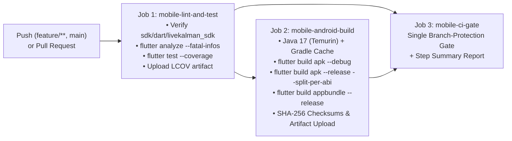

# Mobile CI/CD Pipeline & Release Engineering

## 1. Branch & Workflow Strategy

The mobile project (`apps/flutter/kalman_mobile`) is integrated into the repository's GitHub Actions automation across three coordinated workflows:

1. **[`.github/workflows/mobile-ci.yml`](../../.github/workflows/mobile-ci.yml)** — Dedicated path-filtered Mobile App CI/CD pipeline triggered on pushes to `main`, `master`, `feature/**` (including `feature/mobile-app`), `fix/**`, pull requests, and manual `workflow_dispatch`.
2. **[`.github/workflows/ci.yml`](../../.github/workflows/ci.yml)** — Full-repository verification DAG updated to run on `feature/**` pushes and execute cross-platform (`ubuntu-latest` + `windows-latest`) `flutter pub get`, `flutter analyze --fatal-infos`, and `flutter test` on `apps/flutter/kalman_mobile` prior to the unified `CI Gate`.
3. **[`.github/workflows/release.yml`](../../.github/workflows/release.yml)** — Tag-driven (`v*`) and snapshot release bundler updated with `build-android-mobile` to publish split-ABI Android APKs (`arm64-v8a`, `armeabi-v7a`, `x86_64`) and Play Store Android App Bundles (`.aab`) with combined `SHA256SUMS.txt` checksums.

---

## 2. Mobile CI/CD Pipeline DAG (`mobile-ci.yml`)



---

## 3. Pipeline Stage Details

### Stage 1 — `mobile-lint-and-test` (`ubuntu-latest`)
- **SDK Contract Gate:** Runs `dart pub get`, `dart analyze --fatal-infos`, and `dart test` in `sdk/dart/livekalman_sdk` to guarantee protobuf/gRPC compatibility before testing the mobile UI.
- **Zero-Warning Static Analysis:** Enforces `flutter analyze --fatal-infos` with `flutter_lints: ^6.0.0`, `prefer_single_quotes`, and `prefer_final_locals`. Any failure surfaces the tail of the analyzer log directly as a GitHub Actions annotation.
- **DSP & Responsive Widget Tests:** Executes `flutter test --coverage --reporter expanded`, validating:
  - Algebraic Riccati steady-state convergence ($K_\infty$, $P_\infty = K_\infty R$) to $10^{-9}$ precision;
  - Innovation $\tilde{y}_k$, covariance $S_k$, and $\text{NIS}_k$ $\chi^2(1)$ calculations;
  - Decision-free BPSK DC-drift recovery (`processBpskFrame` parity with `shared/dsp/kalman.go`);
  - Compact phone (`390×844`) and tablet (`1024×768`) layouts across all 4 tabs without render overflow.
- **Coverage Artifact:** Uploads `apps/flutter/kalman_mobile/coverage/lcov.info` (`kalman-mobile-coverage`, 14-day retention).

### Stage 2 — `mobile-android-build` (`ubuntu-latest`)
- **Pinned Toolchain:** Temurin JDK `17` + Flutter `3.47.5` + Gradle `8.14` / Android Gradle Plugin `8.11.1` / Kotlin `2.2.20`, with `~/.gradle/caches` and `~/.gradle/wrapper` keyed on Gradle script hashes.
- **Produced Artifacts:**
  - `kalman-mobile-android-debug-apk`: `kalman-mobile-debug.apk` for quick emulator/device debugging.
  - `kalman-mobile-android-release-bundle`:
    - `kalman-mobile-arm64-v8a-release.apk` (modern 64-bit Android phones)
    - `kalman-mobile-armeabi-v7a-release.apk` (32-bit ARM devices)
    - `kalman-mobile-x86_64-release.apk` (Android Studio x86_64 emulators)
    - `kalman-mobile-release.aab` (Google Play App Bundle)
    - `SHA256SUMS.txt` (printed to `$GITHUB_STEP_SUMMARY` and bundled in the artifact).

### Stage 3 — `mobile-ci-gate` (`ubuntu-latest`, `if: always()`)
- Aggregates `mobile-lint-and-test` and `mobile-android-build` into a single status check suitable for GitHub branch protection rules on `main`.

---

## 4. Reproducing CI Locally

```bash
# 1. Verify shared Dart gRPC SDK
(cd sdk/dart/livekalman_sdk && dart pub get && dart analyze --fatal-infos && dart test)

# 2. Lint & test the mobile app with coverage
(cd apps/flutter/kalman_mobile && flutter pub get && flutter analyze --fatal-infos && flutter test --coverage)

# 3. Build Android APK & AppBundle (requires JDK 17 + Android SDK)
(cd apps/flutter/kalman_mobile && flutter build apk --debug && flutter build apk --release --split-per-abi && flutter build appbundle --release)
```
