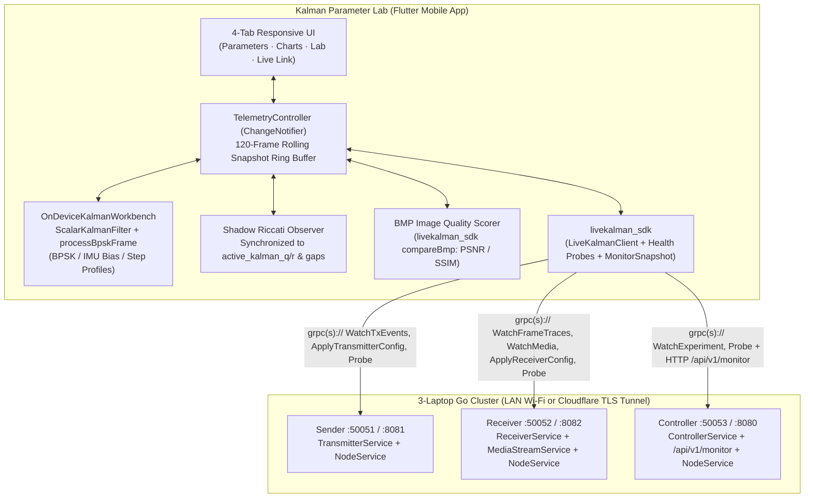
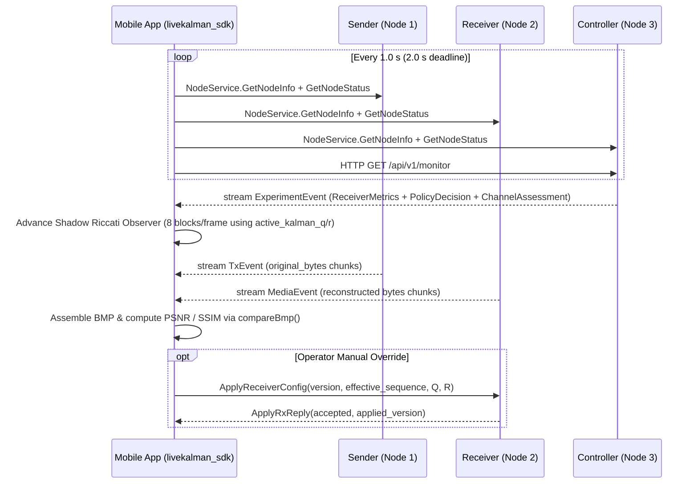

# Mobile Application System & Software Design

## 1. Objective & Design Philosophy

**Kalman Parameter Lab** (`apps/flutter/kalman_mobile`) is a mobile-first scientific telemetry and experimentation console designed to measure, derive, visualize, and tune **every parameter** of the adaptive scalar Kalman filter and BPSK communications link.

Consistent with the platform's engineering principles (`docs/architecture.md` and `docs/ml-monitoring.md`), the mobile application enforces strict **data provenance transparency**:

1. **Direct Wire / Sensor Measurements** (`x_k`, `Q`, `R`, `z_k`, `SNR`, `σ̂²`, `BER`, `PSNR`, `SSIM`, `latency_ms`, `sequence_gaps`) are displayed unaltered and become `—` (`null`) rather than fabricated zeros whenever unavailable (for example, `BER` without simulation reference bits, or `PSNR`/`SSIM` outside BMP transfers).
2. **Deterministic Riccati Quantities** (`P_k^-`, `P_k`, `K_k`, `K_∞`, `P_∞`, `S_k`, `ỹ_k`, `NIS_k`) are computed directly in On-Device Lab mode, and reconstructed in Live 3-Node gRPC mode by a synchronized **Shadow Riccati Observer** driven by the Receiver's exact applied `(active_kalman_q, active_kalman_r, sequence_gaps)` stream. Each card explicitly badges whether its reading is `Direct`, `Riccati Derived`, `ML Policy`, or `Not Measured`.
3. **Sample-Rate Separation:** In Live mode, the Go Receiver (`server/receiver`) retains ownership of 48 kHz sample-rate DSP; the mobile app subscribes to bounded frame traces and per-frame metrics so mobile battery and Wi-Fi bandwidth stay predictable.

---

## 2. High-Level Architecture



---

## 3. Module Decomposition

```text
apps/flutter/kalman_mobile/
├── android/                                   # Gradle 8.14 / AGP 8.11 / Kotlin 2.2 Android host
│   └── app/src/main/AndroidManifest.xml       # INTERNET, ACCESS_NETWORK_STATE, LAN cleartext support
├── lib/
│   ├── main.dart                              # App entry, dark telemetry theme, responsive 4-tab shell
│   ├── models/
│   │   └── kalman_parameters.dart             # KalmanParameterSnapshot, Riccati equations, 25 descriptors
│   ├── dsp/
│   │   └── kalman_engine.dart                 # ScalarKalmanFilter, processBpskFrame, OnDeviceKalmanWorkbench
│   ├── services/
│   │   └── live_telemetry_controller.dart     # Mode switching, gRPC backoff streams, Shadow Riccati Observer
│   └── widgets/
│       ├── parameter_cards.dart               # ParameterMetricTile & interactive Formula Bottom Sheet
│       └── telemetry_charts.dart              # CustomPaint MultiSeriesChartCard oscilloscope traces
└── test/
    ├── kalman_engine_test.dart                # Riccati convergence, NIS math, BPSK parity & URI unit tests
    └── widget_test.dart                       # Phone (390×844) & tablet (1024×768) widget verification
```

---

## 4. Dual Operating Modes & Data Flows

### 4.1 Mode A — On-Device Kalman Workbench (`TelemetrySourceMode.onDeviceLab`)

Designed for offline classroom demonstrations, parameter intuition building, and CI/hardware self-test without needing three laptops on Wi-Fi:

- **Drifting BPSK Link Profile:** Generates 64-symbol, 512-sample frames (`samplesPerSymbol = 8`) with Ornstein-Uhlenbeck DC drift (`DriftReversion = 0.0008`), sinusoidal slow amplitude fading, and white Gaussian noise, then runs `processBpskFrame` (exact port of `shared/dsp/kalman.go`) averaging 8-symbol blocks (`dcBlockSymbols = 8`) to update `ScalarKalmanFilter`.
- **IMU Tilt / Gyro Bias Profile:** Simulates a continuous 1-axis MEMS sensor bias random walk with low-frequency drift and Gaussian measurement noise.
- **Step-Response Benchmark Profile:** Alternates $\pm 0.75\text{ V}$ step transitions every 40 steps (plus manual $+0.65\text{ V}$ impulse injection) so the user can directly measure transient innovation $\tilde{y}_k$, $\text{NIS}_k$ $\chi^2(1)$ gate excursions, and Kalman settling time as a function of $\rho = Q/R$.

### 4.2 Mode B — 3-Node Live gRPC & HTTP Telemetry (`TelemetrySourceMode.liveThreeNodeGrpc`)



### 4.3 Shadow Riccati Covariance Synchronization

On the Go Receiver (`shared/dsp/kalman.go`), `Kalman.P` and local `gain` evolve deterministically from `P_0 = 1`, `Q`, `R`, and stream resets:

$$P_k^- = P_{k-1} + Q, \qquad K_k = \frac{P_k^-}{P_k^- + R}, \qquad P_k = (1 - K_k) P_k^-$$

Notice that neither $P_k$ nor $K_k$ depends on the sample values $z_k$—a fundamental property of linear-Gaussian Kalman filters! Because `ReceiverMetrics` reports `active_kalman_q`, `active_kalman_r`, and `sequence_gaps` on every frame (8 DC-block updates per 64-symbol frame), the mobile app's `_liveRiccatiObserver` tracks the exact Riccati trajectory $(P_k^-, P_k, K_k, S_k)$ and evaluates frame-level innovation $\tilde{y}_k = \text{frame\_mean} - \text{dc\_estimate}$ and $\text{NIS}_k = \tilde{y}_k^2 / S_k$ without modifying the protobuf wire contract.

---

## 5. Mobile Networking, Resilience & Security Boundaries

| Aspect | Design Implementation |
| :--- | :--- |
| **URI Endpoint Grammar** | `grpc://<ctrlHost>:<ctrlPort>?txHost=<ip>&rxHost=<ip>&txPort=50051&rxPort=50052&controllerHttpPort=8080` |
| **Android Emulator Loopback** | Defaults to `10.0.2.2` (`defaultMobileEndpoint`), mapping cleanly to host `127.0.0.1` ports `55051–55053` and `8080`. |
| **LAN Wi-Fi vs Remote TLS** | `grpc://` selects plaintext HTTP/2 for isolated 3-laptop Wi-Fi labs (`android:usesCleartextTraffic="true"`). `grpcs://` selects TLS `ChannelCredentials.secure()` on port `443` for Cloudflare Tunnel remote access. |
| **Auto-Reconnection** | Every gRPC stream (`WatchExperiment`, `WatchFrameTraces`, `WatchTxEvents`, `WatchMedia`) resubscribes on disconnect/error using exponential backoff (`0.5 s, 1 s, 2 s, 4 s, 8 s` cap + random jitter via `lk.reconnectDelay`). |
| **Memory & Battery Bounds** | Rolling telemetry buffer is capped at `maxHistoryLength = 120` snapshots; on-device simulation defaults to `10 Hz` (`100 ms` tick) and pauses cleanly on demand. |
| **Production Hardening** | Outside isolated laboratory Wi-Fi, disable cleartext traffic via an Android Network Security Config XML, enforce `grpcs://` with mutual/server TLS, and sign release builds with a dedicated Play App Signing keystore. |
