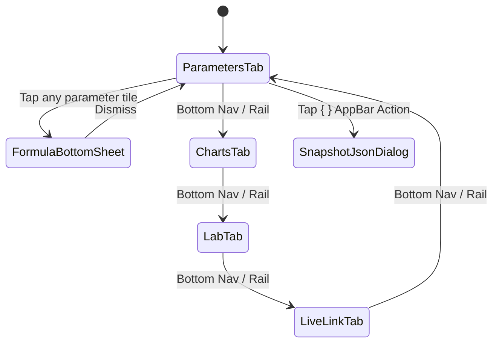

# Mobile UI/UX & Responsive Interaction Specification

## 1. Visual Language & Design Tokens

The mobile interface shares the laboratory's high-contrast dark oscilloscope aesthetic so operators moving between laptop consoles (`apps/flutter/signal_monitor`) and handheld phones experience identical semantic color cues:

| Token | Hex | Role |
| :--- | :--- | :--- |
| `kBgInk` | `#071116` | Deep oscilloscope background & plot canvas |
| `kSurface` | `#0D1A21` | Card & navigation bar container surface |
| `kSurfaceHigh` | `#132630` | Elevated badge & hero summary gradient |
| `kLine` | `#213844` | 1 px hairline card borders & chart gridlines |
| `kMint` | `#58F3C2` | Direct telemetry, healthy gate (`NIS <= 3.841`), posterior state $x_k$ |
| `kBlue` | `#74A9FF` | Deterministic Riccati covariance/gain ($P_k, K_k$), live gRPC link badge |
| `kViolet` | `#B68CFF` | ML policy & tracking ratio $\rho = Q/R$, steady-state $K_\infty$ |
| `kAmber` | `#FFD166` | Gate warnings, ground-truth reference drift, $\pm 2\sqrt{S_k}$ envelope |
| `kRose` | `#FF7B9C` | Innovation excursions, bit error rate (`BER`), disconnected link state |

All numeric readouts use tabular `monospace` typography to prevent horizontal jitter during 10 Hz live updates.

---

## 2. Navigation & Responsive Layout Hierarchy

### Adaptive Viewport Breakpoints

| Viewport Class | Width Range | Navigation Chrome | Parameter Matrix Layout |
| :--- | :--- | :--- | :--- |
| **Compact Phone** | `< 560 dp` | Material 3 bottom `NavigationBar` | 1-column vertical `SliverList` (zero horizontal clipping) |
| **Foldable / Large Phone** | `560 – 839 dp` | Material 3 bottom `NavigationBar` | 2-column `SliverGrid` (`mainAxisExtent: 128`) |
| **Tablet / Landscape** | `>= 840 dp` | Left `NavigationRail` | 3-column `SliverGrid` (`mainAxisExtent: 128`) |

---

## 3. Screen-by-Screen Functional Specification

### 3.1 Top AppBar (Persistent Across Tabs)
- **Source & Sequence Badge:** Shows active mode (`On-Device Lab · #142` or `3-Node Live gRPC · #1520`) color-coded mint vs blue.
- **Play / Pause Action:** Single-tap pause/resume for freezing transient waveforms during inspection.
- **JSON Telemetry Export (`{ }`):** Opens a selectable/copyable formatted JSON modal containing the full `KalmanParameterSnapshot` payload for lab reports.

### 3.2 Tab 1 — `Parameters` (All-Parameter Matrix)
- **Hero Summary Strip:** Instantaneous at-a-glance readout of $x_k$, $K_k$, $P_k$, $\rho = Q/R$, and $\text{NIS}_k$ $\chi^2(1)$ consistency status (`✓` vs `!`).
- **Real-Time Search & Category Filter Chips:** Filters all 25 parameters by symbol, name, description, or domain (`All (25)`, `State & Covariance`, `Noise & Innovation`, `Channel & Signal`, `Adaptive & ML`).
- **Interactive Formula Bottom Sheet:** Tapping any `ParameterMetricTile` opens its exact mathematical equation, physical unit, description, provenance badge, and live value.

### 3.3 Tab 2 — `Charts` (Synchronized 4-Channel Oscilloscope)
1. **State Tracking:** Raw $z_k$ vs Ground-Truth DC (dashed amber, when available) vs Kalman posterior $x_k$ (bold mint).
2. **Riccati Convergence:** Dynamic gain $K_k$ vs asymptotic $K_\infty$ (dashed violet) alongside posterior covariance $P_k$.
3. **Innovation Consistency Gate:** Zero-centered symmetric plot of innovation $\tilde{y}_k$ bounded by dashed $\pm 2\sqrt{S_k}$ ($95\%$ confidence envelope).
4. **Channel & Policy Timeline:** Synchronized `SNR (dB)`, scaled tracking ratio `100 · ρ`, and `BER (%)`.

### 3.4 Tab 3 — `Lab` (Interactive On-Device Workbench)
- **Stream Profile Selector:** `Drifting BPSK Link`, `IMU Tilt / Gyro Bias`, and `Step-Response Benchmark`.
- **Transient Controls:** `Single Step`, `+0.65 V Step Impulse` (immediately tests $\text{NIS}_k$ spike & $K_k$-driven recovery), and `Reset State`.
- **Covariance & Impairment Sliders:** Toggle `Adaptive Rule Policy` ($\rho = 0.0268$) or manually sweep $Q$, $R$, AWGN $\sigma$, DC drift $\sigma_d$, and slow fading depth.

### 3.5 Tab 4 — `Live Link` (3-Node gRPC & HTTP Console)
- **Mode Segmented Switch:** Seamless switch between `On-Device Lab` and `3-Node Live gRPC`.
- **Endpoint URI Input:** Supports LAN Wi-Fi (`grpc://192.168.1.30:50053?...`), Android Emulator loopback (`grpc://10.0.2.2:55053?...`), and TLS Cloudflare Tunnels (`grpcs://...`).
- **Topology Health Matrix:** Displays 1-second `NodeService` probe states (`Connected`, `Reconnecting`, `Service Unavailable`) and data-flow activity for **Sender**, **Receiver**, and **Controller**, plus individual stream badges (`WatchExperiment`, `WatchFrameTraces`, `WatchTxEvents`, `WatchMedia`).
- **Remote `RxConfig` Override:** Dispatches versioned `ApplyReceiverConfig` commands scheduled for a future frame boundary (`effective_sequence = latest + 4`).
