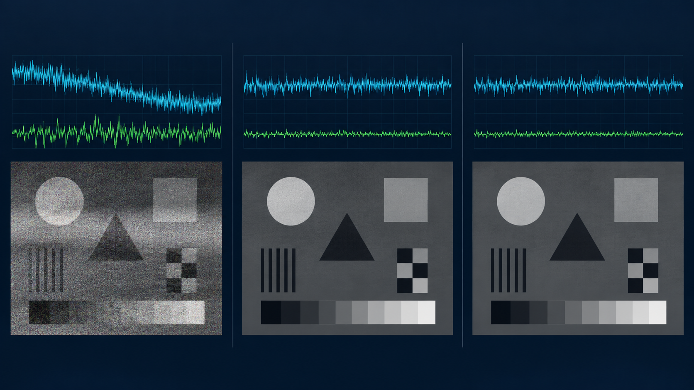
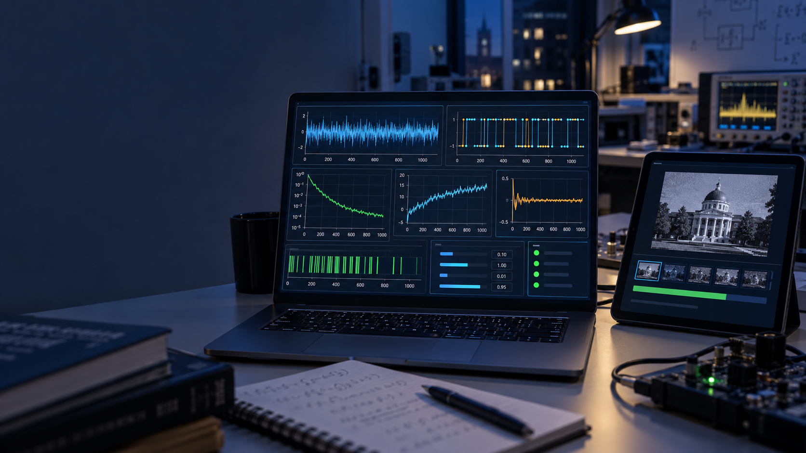

# Experimental Results & Benchmark Data (`results/`)

This directory consolidates the reproducible simulation tables, live 3-node transfer benchmarks, end-to-end verification metrics, and visual figures for the **Adaptive Kalman Filter BPSK Streaming Platform**.

All tabular CSV files in this directory are deterministically generated from [`ml/data/dataset.csv`](../ml/data/dataset.csv) and [`ml/models/report.json`](../ml/models/report.json) via [`ml/export_results.py`](../ml/export_results.py), and checked for zero drift in GitHub Actions CI (`python ml/export_results.py --check`).

---

## Directory Contents

| File | Description |
| --- | --- |
| [`policy_ber_benchmarks.csv`](policy_ber_benchmarks.csv) | Held-out 1,200-channel BER comparison across Oracle, ONNX MLP, Best Fixed $\rho = 0.0268$, and No Drift Tracking across SNR bands |
| [`dataset_channel_regimes.csv`](dataset_channel_regimes.csv) | Breakdown of all 6,000 simulated channels (`cmd/datagen`) by physical impairment regime (AWGN, DC drift, slow fading, burst noise, combined) |
| [`rho_grid_sensitivity.csv`](rho_grid_sensitivity.csv) | Full 29-point logarithmic sweep of Kalman $\rho = Q/R \in [10^{-7}, 10]$ showing the tradeoff between drift lag and symbol-jitter leakage |
| [`live_transfer_benchmarks.csv`](live_transfer_benchmarks.csv) | Live 3-server impaired BMP transfer results (`configs/local-impaired.json`) and ESP32 Nanopb HTTP wire-contract transfers (`hello.txt`, `kalman.bmp`, `tone.wav`) |
| [`e2e_verification_summary.json`](e2e_verification_summary.json) | Structured summary of ML parity (`gonnx` vs `onnxruntime` vs `scikit-learn`) and live 3-node gRPC/SSE/HTTP verification (`scripts/verify_e2e.py`) |
| [`figures/`](figures/) | Visual comparisons of reconstructed media, Kalman tracking curves, gRPC/Protobuf streams, and monitoring dashboards |

---

## 1. Held-Out Simulation Benchmarks (1,200 Channels)

Evaluated on the held-out 20% split (`1,200` channels out of `6,000` generated by `cmd/datagen` using the production `dsp.Channel` and `dsp.ProcessBPSK` routines):

| Policy | Mean BER (All) | Mean BER (Drift Channels) | SNR < 0 dB | 0–5 dB | 5–10 dB | > 10 dB | Drift Gain vs No-Tracking |
| --- | ---: | ---: | ---: | ---: | ---: | ---: | ---: |
| **Oracle** (best $\rho$ per channel) | `0.0609` | `0.0788` | `0.1625` | `0.0289` | `0.0135` | `0.0022` | `-14.61%` |
| **ONNX MLP** (`r_policy.onnx`) | **`0.0619`** | **`0.0812`** | **`0.1639`** | **`0.0302`** | **`0.0145`** | **`0.0028`** | **`-12.01%`** |
| **Rule Policy** (best fixed $\rho = 0.0268$) | `0.0625` | `0.0814` | `0.1651` | `0.0304` | `0.0148` | `0.0031` | `-11.82%` |
| **No Drift Tracking** ($\rho = 10^{-7}$) | `0.0657` | `0.0923` | `0.1652` | `0.0357` | `0.0196` | `0.0075` | `0.00%` |

- **Cross-Runtime Numerical Parity**:
  - `onnxruntime` vs `scikit-learn` max absolute `log(rho)` difference: **`2.86e-6`** (`ml/models/report.json`)
  - Pure-Go `gonnx` vs `onnxruntime` 32 golden vectors (`ml/models/r_policy.golden.json`): verified within **`1e-4`** (`go test ./server/controller/extensions/mlpolicy`)



---

## 2. Live 3-Node Media Transfer Benchmarks

### Impaired Channel (`configs/local-impaired.json`, 9,270-byte `kalman.bmp`, 1,159 frames)

| Controller Policy | Observed File BER | Change vs No-Tracking | Visual Outcome |
| --- | ---: | ---: | --- |
| No Drift Tracking ($\rho = 10^{-7}$) | `0.0730` | Baseline | Heavy horizontal stripe corruption during DC excursions |
| Rule Policy (fixed $\rho = 0.0268$) | `0.0580` | **`-20.5%`** | Structure preserved via block-mean Kalman DC removal + XOR scrambling |
| ONNX Policy (`ml/models/r_policy.onnx`) | `0.0591` | **`-19.0%`** | Dynamic per-window $Q/R$ adaptation in pure Go (`gonnx`) |


### Embedded ESP32 Nanopb HTTP Ingest (`POST :8082/api/v1/frames`)

| Payload | Bytes | Frames (`8 B/frame`) | Detected MIME Type | CRC-32 & SHA-256 Match |
| --- | ---: | ---: | --- | --- |
| `examples/media/hello.txt` | `103` | `13` | `text/plain; charset=utf-8` | Exact (`0.0000` BER) |
| `examples/media/kalman.bmp` | `9,270` | `1,159` | `image/bmp` | Exact (`0.0000` BER) |
| `examples/media/tone.wav` | `8,044` | `1,006` | `audio/wav` | Exact (`0.0000` BER) |

---

## 3. System Pipeline & Telemetry Visuals

### Media Framing, Scrambling & Reconstruction Pipeline


### Distributed gRPC & Protobuf Streaming Contracts


### Live Multi-Role Signal Monitor Dashboard


---

## Reproducing All Results

```powershell
# Verify ONNX graph contract, golden vectors, and BER gains
python ml/verify_model.py --models-dir ml/models --min-r2 0.40 --require-drift-gain

# Export or verify CSV tables against ml/data/dataset.csv and ml/models/report.json
python ml/export_results.py
python ml/export_results.py --check

# Run live 3-node + ONNX + ESP32 Nanopb end-to-end verification
python scripts/verify_e2e.py
```
